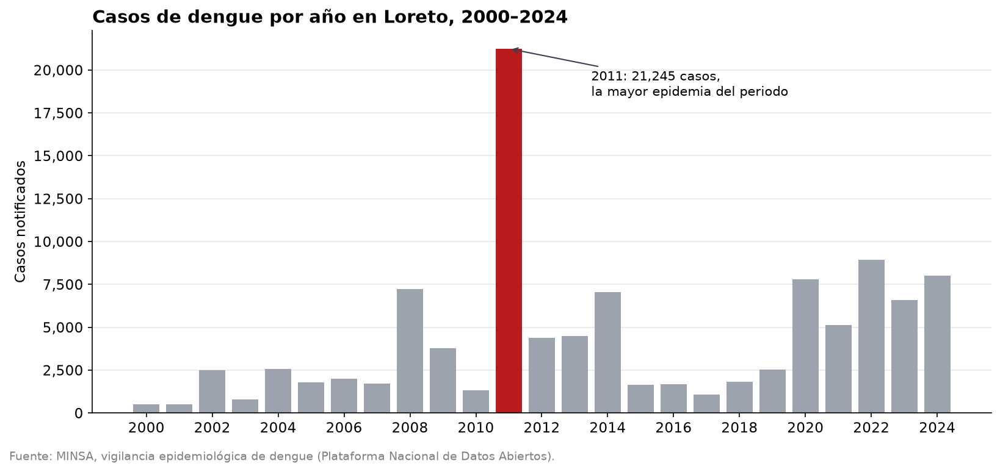
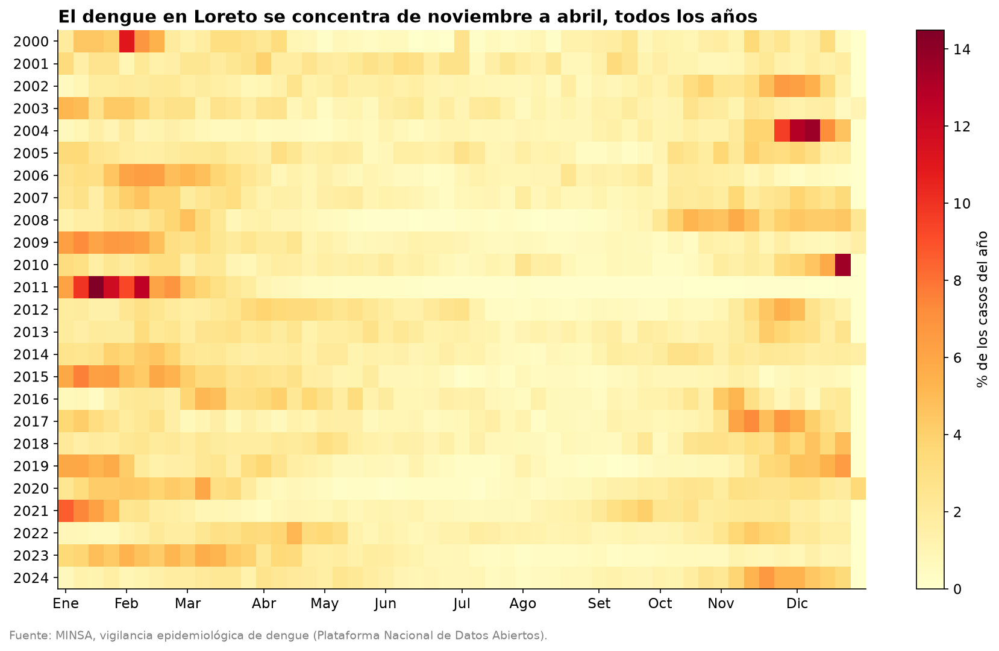
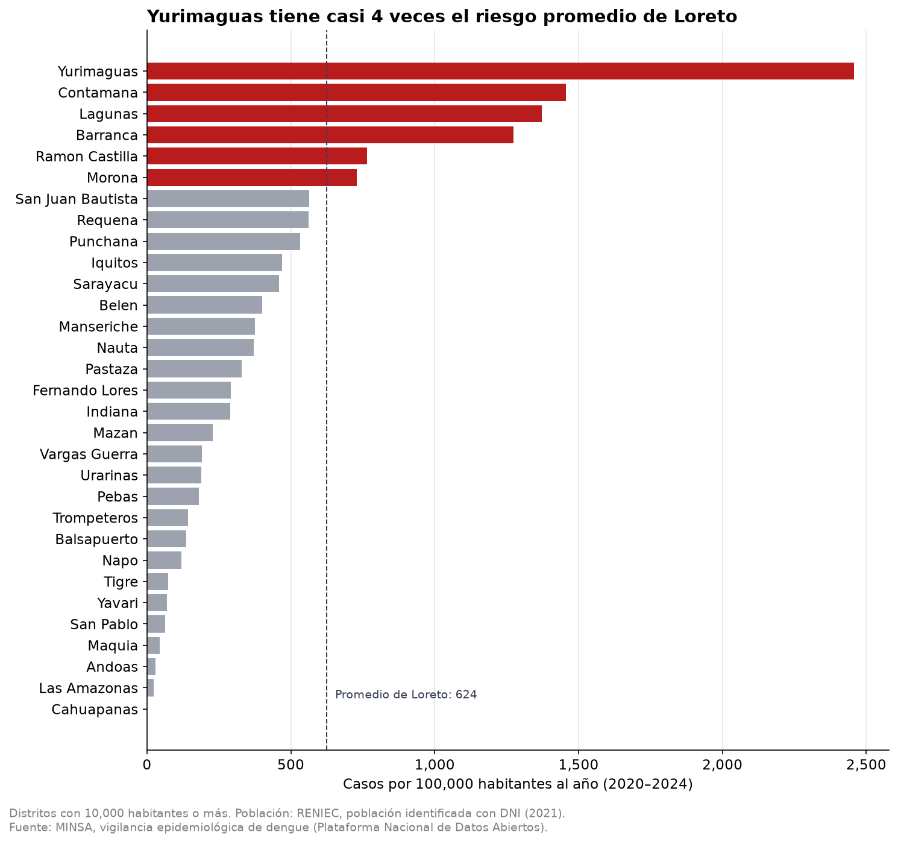
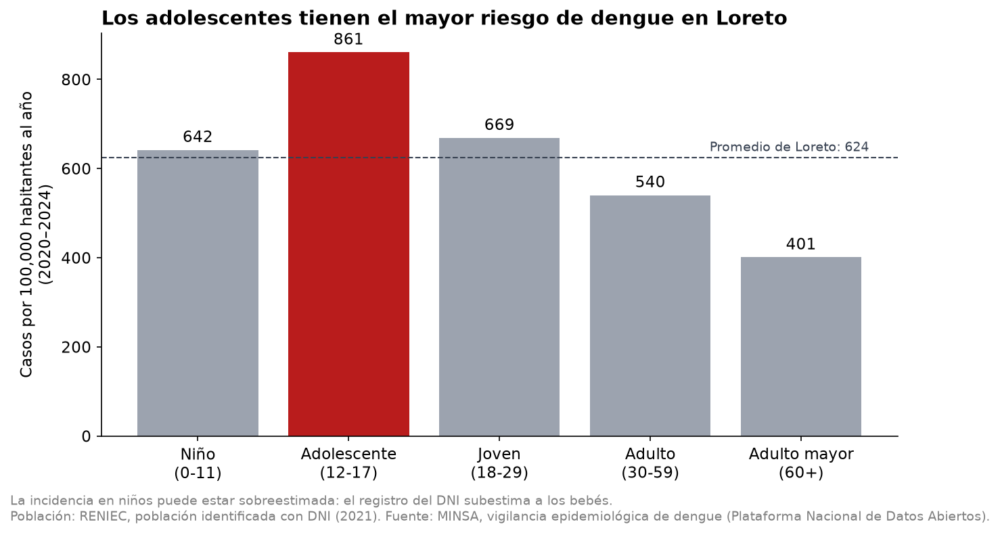

# 🦟 Dengue en Loreto (2000–2024): ¿cuándo, dónde y a quiénes afecta más?


Análisis de **107,074 casos de dengue** notificados entre 2000 y 2024 con lugar probable de infección en Loreto, a partir de los datos abiertos de vigilancia epidemiológica del MINSA, y cálculo del **riesgo por habitante (incidencia)** con datos de población del RENIEC.

## 🎯 Pregunta de análisis

¿Cuándo, dónde y a quiénes afecta más el dengue en Loreto, y en qué se diferencia de la tendencia nacional?

Loreto es el **tercer departamento del Perú con más casos de dengue** registrados entre 2000 y 2024, detrás de Piura y Lima, y concentra el **10.4%** del total nacional. A nivel nacional, 2023 y 2024 fueron años récord: juntos suman más de 528,000 casos, más de la mitad de todo el registro.

## 📌 En resumen

- **Cuándo:** de noviembre a abril, con el pico en enero y febrero. Desde 2020, los casos se mantienen altos todos los años.
- **Dónde:** la ciudad de Iquitos tiene la mayoría de los casos, pero **el mayor riesgo por habitante está fuera de ella: en Yurimaguas es casi 4 veces el promedio de Loreto**.
- **A quiénes:** **los adolescentes** (12-17 años) son el grupo con más riesgo; desde los 18 años, el riesgo baja con la edad.
- **Diferencia con el país:** Loreto no siguió la ola nacional de 2023–2024; su mayor epidemia fue en 2011.

## 📊 Resultados

### 1. ¿Cuándo? Una historia epidémica propia y un presente alto



- **2011 fue la mayor epidemia del periodo:** 21,245 casos, 2.4 veces más que el segundo año (2022, con 8,926).
- **Loreto no siguió la ola nacional de 2023–2024:** registró 6,582 y 7,996 casos, el 31% y el 38% del máximo de 2011.
- **Desde 2020, ningún año baja de 5,000 casos** (promedio de unos 7,280 al año), frente a un promedio de unos 1,760 en 2015–2019.

### 2. ¿Cuándo? Una temporada que se repite



- **El 67.4% de los casos ocurre entre noviembre y mediados de abril**, con el pico en enero y febrero. Entre julio y setiembre se registran los niveles más bajos: el primer trimestre concentra el triple de casos que el tercero.
- **Las epidemias cruzan el cambio de año:** la de 2011 empezó a fines de 2010, por lo que el análisis por año calendario puede partir una misma epidemia en dos.
- La temporada **no coincide con el pico de calor de Iquitos** (setiembre a noviembre), identificado en mi proyecto [Índice de calor en Iquitos](https://github.com/David-Sac/clima-iquitos): los casos empiezan a subir cuando termina esa temporada y llegan a su pico dos o tres meses después. Una hipótesis por comprobar es que la lluvia, que forma criaderos de mosquitos, esté más relacionada que el calor.

### 3. ¿Dónde? Muchos casos en Iquitos, más riesgo fuera de la ciudad



- **En casos, domina la ciudad de Iquitos:** sus cuatro distritos (Iquitos, San Juan Bautista, Punchana y Belén) concentran el **64.6%** de los casos de 2000–2024.
- **En riesgo por habitante, no** (incidencia 2020–2024): **Yurimaguas tiene 2,456 casos por 100,000 habitantes al año**, casi 4 veces el promedio de Loreto (624). Los cuatro distritos de la ciudad de Iquitos están por debajo del promedio; en conjunto, alrededor de 498.
- Por provincia, **Alto Amazonas** (1,748) casi triplica el promedio, mientras que Maynas (445) está por debajo. Entre 2020 y 2024, Alto Amazonas incluso superó a Maynas en número de casos.
- **Los 6 distritos grandes con mayor riesgo son, casi todos, pueblos y capitales a orillas de grandes ríos:** Yurimaguas, Contamana, Lagunas, Barranca, Ramón Castilla y Morona.

### 4. ¿A quiénes? Los adolescentes tienen el mayor riesgo



- **Los adolescentes (12-17) tienen la mayor incidencia:** 861 casos por 100,000 al año, un 38% más que el promedio de Loreto. Son el 14.3% de la población, pero el 19.7% de los casos.
- **Los niños (0-11) están prácticamente en el promedio** (642), y **desde los 18 años el riesgo baja con la edad**: 669 en jóvenes, 540 en adultos y 401 en adultos mayores.
- La edad mediana de los casos es de **21 años**. Que el 42.7% de los casos sean menores de 18 se explica en parte por el peso de ese grupo en la población (40.2%); la diferencia real está en los adolescentes.
- **La gravedad es similar en todas las edades:** desde 2010, el **19.8%** de los casos presenta signos de alarma o es grave, entre el 18.1% (adultos) y el 22.0% (adolescentes). Cerca de 1 de cada 5 casos necesita atención especial, a cualquier edad.
- El **52.4%** de los casos corresponde a mujeres.

## 💡 Implicaciones

- **Prevención antes de la temporada alta:** las campañas de eliminación de criaderos tendrían más impacto en octubre y comienzos de noviembre, antes de que los casos empiecen a subir.
- **Preparación de los servicios de salud para enero y febrero**, el periodo con más casos y, por lo tanto, con más pacientes con signos de alarma.
- **Priorizar por riesgo, no solo por número de casos:** Iquitos necesita recursos por su volumen de casos, pero Yurimaguas y los pueblos ribereños con mayor incidencia (Contamana, Lagunas, Barranca) necesitan atención proporcional a su riesgo.
- **Los adolescentes como grupo prioritario:** los colegios pueden ser un espacio clave para la prevención y la detección temprana.
- **Vigilar los signos de alarma en pacientes de todas las edades**, no solo en niños y adultos mayores.
- **Revisar la cobertura de la notificación** en distritos sin casos registrados, como Cahuapanas (10,786 habitantes y ningún caso en 2020–2024).

## 🗂️ Datos

| | |
|---|---|
| **Fuente** | [Vigilancia epidemiológica de dengue – Plataforma Nacional de Datos Abiertos](https://www.datosabiertos.gob.pe/dataset/vigilancia-epidemiol%C3%B3gica-de-dengue) |
| **Publicado por** | Centro Nacional de Epidemiología, Prevención y Control de Enfermedades (CDC Perú – MINSA) |
| **Archivo** | `datos_abiertos_vigilancia_dengue_2000_2024.csv` (103 MB) |
| **Cobertura** | Perú, 2000–2024 · 1,029,421 casos notificados |
| **Unidad de análisis** | Un caso de dengue por fila |
| **Filtro aplicado** | Lugar probable de infección: departamento de Loreto (107,074 casos) |

**Datos complementarios para la incidencia**

| | |
|---|---|
| **Población** | *Población identificada con DNI – Setiembre 2021*, RENIEC (Plataforma Nacional de Datos Abiertos), por distrito, edad y sexo |
| **Equivalencias de ubigeo** | Tabla de códigos INEI y RENIEC por distrito: [ubigeo-peru-aumentado](https://github.com/jmcastagnetto/ubigeo-peru-aumentado) |

**Variables utilizadas:** provincia, distrito y ubigeo (lugar probable de infección), año y semana epidemiológica de inicio de síntomas, forma clínica, dirección de salud que notifica, edad y sexo.

> ⚠️ El archivo original no se incluye en el repositorio porque supera el límite de 100 MB de GitHub. Para reproducir el análisis, descárgalo desde el enlace de la fuente y guárdalo en `data/raw/`.

## 🧹 Metodología

**Exploración y calidad de datos** (`01_exploracion.ipynb`)

1. Identificación del separador (`;`) y detección de la codificación del archivo.
2. Carga indicando como texto los códigos (`ubigeo`, `diresa`) y la edad, para no perder ceros a la izquierda ni mezclar unidades.
3. Comparación de las columnas reales con el diccionario de datos: falta `tipo_dx` y sobran `localidad` y `localcod`.
4. Diagnóstico y corrección de nombres con caracteres dañados (ñ y tildes), usando el `ubigeo` para recuperar la versión correcta de cada nombre dentro del propio dataset.
5. Validación del total de 2023 contra la cifra reportada para ese año: el dataset contiene alrededor del **94%** de los casos.
6. Filtro de Loreto por lugar probable de infección (`departamento`), no por la dirección de salud que notifica (`diresa`).

**Limpieza y preparación** (`02_limpieza.ipynb`)

7. Conversión de todas las edades a años: la edad viene registrada en años, meses o días según `tipo_edad`.
8. Validación de edades: rango de 0 a 104 años, sin valores imposibles.
9. Grupos de edad según las etapas de vida del MINSA: niño, adolescente, joven, adulto y adulto mayor.
10. Gravedad como variable categórica ordenada: sin signos de alarma, con signos de alarma y grave.
11. Validación de sexo y semanas epidemiológicas, y comprobación de que la limpieza no eliminó ningún caso.

**Análisis con SQL** (`03_sql.ipynb`)

12. Carga de los casos en una base de datos SQLite y verificación de la carga.
13. Consultas por año, provincia y distrito, agrupando por `ubigeo` y mostrando el nombre como etiqueta.
14. Porcentaje de casos con signos de alarma o graves por año, con `SUM` y `AVG` sobre una variable binaria.
15. Detección de un **cambio de clasificación en 2010**: antes de ese año casi ningún caso figura con signos de alarma. Por eso el análisis de gravedad se limita a 2010–2024.
16. Comparación de periodos con `CASE WHEN` y filtro de años epidémicos con `HAVING`.
17. **Estacionalidad:** porcentaje de los casos de cada año que ocurre en cada semana, calculado con CTE y una función de ventana (`SUM() OVER (PARTITION BY ano)`), para que los años con más casos no dominen el patrón. El promedio entre años considera como 0 las semanas sin casos, y se validó que el patrón promedio sume 100%.
18. **Gravedad por grupo de edad** (2010–2024), ordenando las categorías con `CASE` dentro del `ORDER BY`.

**Población e incidencia** (`03_sql.ipynb`, sección 10)

19. Carga del registro de población del RENIEC: separador `;`, codificación UTF-8 con BOM y una fila final sin datos.
20. **Validación de los códigos de distrito:** la columna `UBIGEO_INEI` del RENIEC tiene códigos incorrectos en tres distritos (Punchana, Indiana y Torres Causana). Se usó `UBIGEO_RENIEC` y una tabla de equivalencias, con un `LEFT JOIN` en pandas para detectar los registros sin pareja. Resultado: 53 distritos y 1,167,197 personas.
21. **Periodo de la incidencia: 2020–2024**, los cinco años alrededor del registro de población (2021), con los códigos de distrito actuales.
22. **Incidencia por distrito:** `LEFT JOIN` en SQL desde la tabla de población, para incluir los distritos sin casos (`COALESCE` para convertir los `NULL` en 0). Validación: ningún caso quedó sin distrito y la suma después del `JOIN` coincide con el total del periodo (36,419).
23. **Incidencia por provincia**, sumando casos y población antes de dividir (no promediando las incidencias de los distritos).
24. **Incidencia por grupo de edad:** población por edad agrupada con los mismos rangos de `pd.cut` que los casos, y comparación entre el porcentaje de casos y el porcentaje de población de cada grupo con `SUM() OVER ()`.

**Visualización** (`04_visualizacion.ipynb`)

25. Cuatro gráficos, uno por cada parte de la pregunta, con un mismo estilo: gris para el contexto, rojo para el hallazgo y títulos que dicen el mensaje.
26. Mapa de calor con porcentajes por año y escala limitada al 6%, para que unas pocas semanas extremas de años con pocos casos no dejen pálido el resto del gráfico.
27. Gráfico de incidencia por distrito solo con distritos de 10,000 habitantes o más, porque en los más pequeños unos pocos casos cambian mucho la cifra.

**Próximas etapas**

28. Dashboard interactivo en Power BI.

## ⚠️ Limitaciones

- **No se distinguen casos confirmados, probables y sospechosos:** el archivo no incluye la columna `tipo_dx` descrita en el diccionario de datos.
- **La clasificación de gravedad cambió alrededor de 2010:** antes de ese año casi ningún caso figura con signos de alarma, probablemente porque se usaban otras categorías. La gravedad solo se compara entre 2010 y 2024.
- **Son datos de vigilancia, con posible sesgo de notificación:** un caso solo aparece si fue atendido y notificado. Los años con pocos casos tienen mayor porcentaje de casos graves (podrían notificarse sobre todo los que llegan a un hospital), y un distrito sin casos registrados no significa necesariamente que no haya dengue.
- **No hay información sobre fallecimientos**, por lo que no se puede analizar la letalidad.
- **El lugar registrado es el de probable infección**, no el de residencia del paciente.
- **Solo se conoce la semana de inicio de síntomas**, no la fecha exacta. Además, las epidemias pueden cruzar el cambio de año, por lo que el análisis por año calendario puede partir una misma epidemia en dos.
- **La población usada es la identificada con DNI en 2021, no la población censal.** En Loreto suma alrededor de un 13% más que las estimaciones oficiales, probablemente porque incluye personas que se mudaron sin actualizar su domicilio y fallecidos aún no dados de baja. Por eso la incidencia calculada es una estimación conservadora. Además, se usa la población de un solo año para todo el periodo 2020–2024.
- **El registro del DNI subestima a los niños más pequeños** (hay 13,443 personas de 0 años frente a 28,719 de 10 años), por lo que la incidencia en niños puede estar ligeramente sobreestimada.
- **En los distritos pequeños, la incidencia es inestable:** unos pocos casos de más o de menos la cambian mucho. Por eso los gráficos muestran solo los distritos con 10,000 habitantes o más.
- **Los distritos cambiaron con el tiempo:** se crearon provincias y distritos nuevos en Loreto, por lo que la incidencia se calcula solo para 2020–2024, con los códigos actuales.
- Las filas idénticas no se eliminan: sin un identificador de paciente, no es posible distinguir un registro duplicado de dos casos reales con las mismas características.

## 🔒 Consideraciones éticas

Aunque los datos son públicos y anonimizados, corresponden a personas reales. Por eso todos los resultados se presentan **agregados** (por distrito, semana, año o grupo de edad), nunca como casos individuales, y no se utiliza la columna `localidad`, que combinada con edad y sexo podría acercarse a identificar personas en comunidades pequeñas.

## 📁 Estructura del proyecto

```
dengue-loreto/
├── data/
│   ├── raw/                            # Datos originales (no se suben a GitHub)
│   │   ├── datos_abiertos_vigilancia_dengue_2000_2024.csv   # Casos de dengue (MINSA)
│   │   ├── 16_OPP_2021_SEP.csv         # Población identificada con DNI (RENIEC)
│   │   └── ubigeo_equivalencias.csv    # Códigos INEI y RENIEC por distrito
│   ├── dengue_loreto.db                # Base de datos SQLite (se genera con el notebook 03)
│   └── processed/
│       ├── dengue_loreto.csv           # Casos de Loreto, columnas seleccionadas
│       └── dengue_loreto_limpio.csv    # Edad en años, grupos de edad y gravedad
├── figures/                            # Gráficos del análisis (notebook 04)
├── notebooks/
│   ├── 01_exploracion.ipynb            # Carga, calidad de datos y filtro de Loreto
│   ├── 02_limpieza.ipynb               # Edades, grupos de edad y gravedad
│   ├── 03_sql.ipynb                    # Análisis con SQL e incidencia
│   └── 04_visualizacion.ipynb          # Gráficos
├── requirements.txt
└── README.md
```

## ▶️ Cómo reproducirlo

```bash
git clone https://github.com/David-Sac/dengue-loreto.git
cd dengue-loreto
python -m venv .venv
.venv\Scripts\activate          # En Windows
pip install -r requirements.txt
```

Luego descarga los archivos de casos de dengue y de población identificada con DNI desde la Plataforma Nacional de Datos Abiertos, guárdalos en `data/raw/` con los nombres de la estructura anterior y ejecuta los notebooks en orden (01 → 04). La tabla de equivalencias de ubigeo se descarga automáticamente.

## 👤 Autor

**David Saccsara** · Data Analyst en formación · Maestría en Ciencia de Datos e IA (UTP, en curso)

[](https://www.linkedin.com/in/davidsacc/)
[](https://github.com/David-Sac)